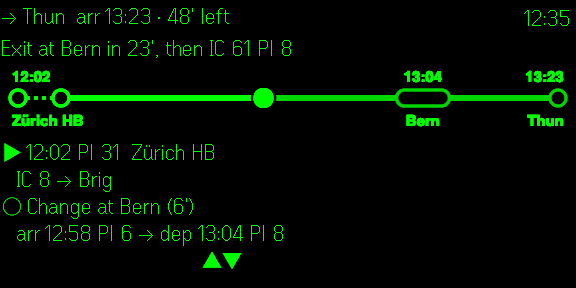
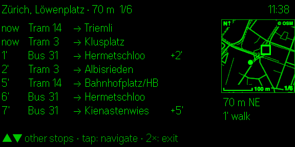
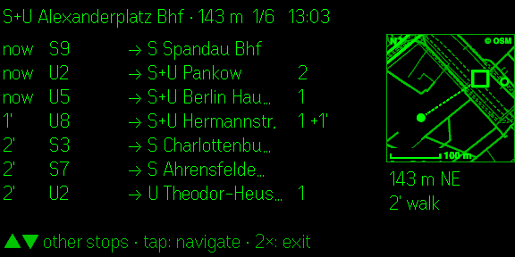
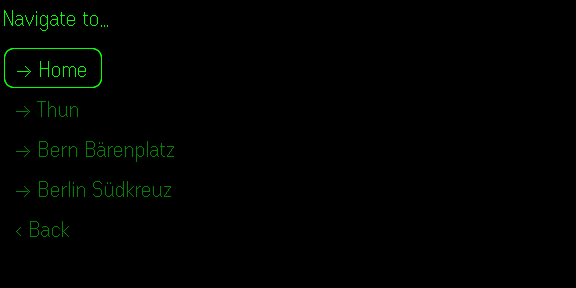
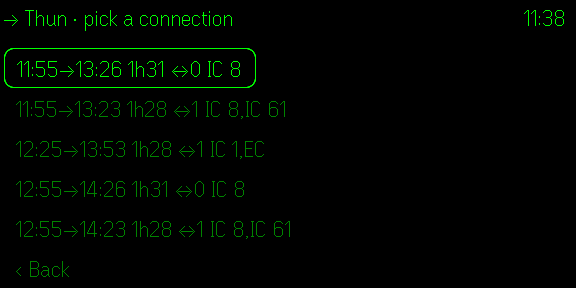
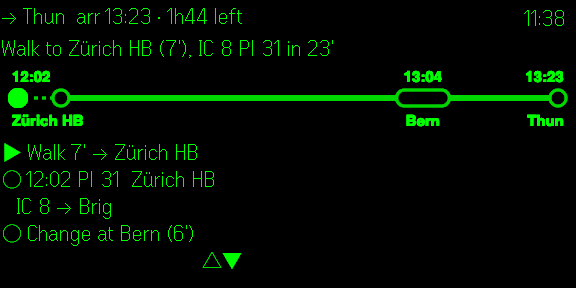
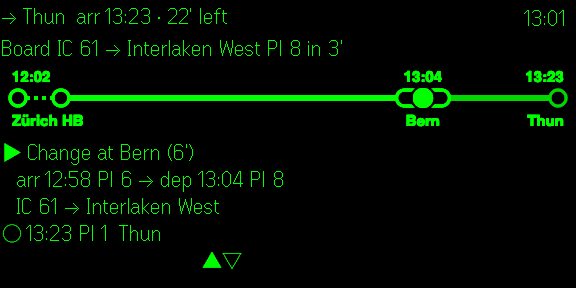
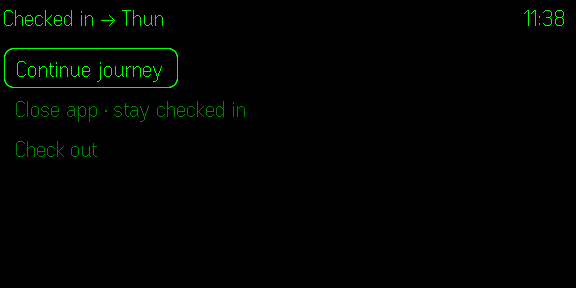

<h1 align="center">Simple euro transit</h1>

<p align="center">
  <b>Public transport on your Even Realities G2 glasses.</b><br>
  Departures around you, a small street map and step-by-step journeys with a live progress line.<br>
  Switzerland and Germany (plus much of Europe), open data only.
</p>

<p align="center">
  
</p>

<p align="center">
  <a href="LICENSE"></a>
  
  
</p>

> **Vibe coded with Claude Code.** This app was built entirely by
> [Claude Code](https://claude.com/claude-code), Anthropic's AI coding agent, from conversational
> prompts. None of the code was written by hand: the app, the tests, the scripts and this
> documentation were all generated in chat. The human part was the ideas, the feedback and the
> testing in the simulator and on the glasses.
>
> Treat it accordingly. It comes without any warranty (see [LICENSE](LICENSE)), it is not an
> official app of any transport company, and timetable information can be wrong or out of date:
> check official sources before you rely on a connection.

## Screenshots

Captured from the Even Hub simulator with live timetable data (576 × 288 px, the resolution of the glasses display).

<table>
<tr>
<td width="50%" valign="top"><br><b>Departures around you</b><br>The closest stop with minutes, line, destination, platform and delay. The map shows where the stop is, with distance, direction and walking time.</td>
<td width="50%" valign="top"><br><b>Also in Germany</b><br>Berlin S-Bahn, U-Bahn, tram and bus via Transitous. The network is picked by location.</td>
</tr>
<tr>
<td width="50%" valign="top"><br><b>Your targets</b><br>Home, work or any stop or address, set up in the phone app.</td>
<td width="50%" valign="top"><br><b>Pick a connection</b><br>Departure, arrival, duration, number of changes and lines at a glance.</td>
</tr>
<tr>
<td width="50%" valign="top"><br><b>The journey as a line</b><br>Every change on the line, with times and platforms in the steps below.</td>
<td width="50%" valign="top"><br><b>On the way</b><br>The dot moves with the timetable, including delays, and is corrected by GPS.</td>
</tr>
<tr>
<td width="50%" valign="top"><br><b>At a change</b><br>Which train, which platform, how many minutes until it leaves.</td>
<td width="50%" valign="top"><br><b>Check in</b><br>Close the app on a long ride and get straight back into your journey.</td>
</tr>
</table>

## Features

- **Departure board** of the closest stops (GPS): minutes to departure, line, destination,
  platform, delay. Swipe to switch between nearby stops.
- **Street map** next to the board: you, the selected stop, the other stops nearby, distance,
  direction and walking time.
- **Navigation** to preset targets (home, work, any stop or address) set up on the phone: pick a
  connection, then follow it on a journey line. A dot moves along it by the timetable (including
  delays) and is corrected by GPS when the train is clearly early or late. Every change shows
  arrival and departure time and platform.
- **Check-in:** the journey you pick is saved. Close the app on a long ride and it opens straight
  into the journey again; it checks out by itself after arrival.
- **Networks:** Switzerland via [transport.opendata.ch](https://transport.opendata.ch), Germany
  and the rest of Europe via [Transitous](https://transitous.org). Picked automatically by
  location, or set by hand.

### On the glasses

| Screen | Tap | Double tap | Swipe |
|---|---|---|---|
| Departure board | targets | exit app | other stop |
| Target / connection list | select | back | move selection |
| Journey | refresh (check out after arrival) | check-in menu | scroll steps |

## Development

Requirements: Node.js 22+, and for testing on glasses the Even Realities app with developer mode.

```bash
npm install
npm run dev          # Vite dev server on port 5173
npm run sim          # Even Hub simulator, opens the dev server with a fixed Zürich position
npm test             # unit tests (vitest)
npm run build        # type check + production build into dist/
npm run pack         # build + simple-euro-transit.ehpk
```

On real glasses during development: `npm run dev`, then `npx evenhub qr --url http://<your-lan-ip>:5173`
and scan the code in the Even Realities app.

### Test parameters (dev server only)

The simulator has no GPS and no Bluetooth delays, so the dev build reads a few URL parameters
(see `src/dev.ts`; production builds ignore the URL):

| Parameter | Effect |
|---|---|
| `lat`, `lng` | fixed position instead of GPS |
| `now=2026-11-04T08:10` | app clock |
| `ff=30` | jump the clock 30 min ahead when a journey starts |
| `targets=Thun\|8507100;Berlin\|de-VBB_de:11000:900058101\|eu` | preset targets (label, stop id or `lat,lng`, network) |
| `jitter=20` | position wanders by up to 20 m every 2 s |
| `slowimg=3000` | every map image transfer takes 3 s longer |
| `perf=1` | timings and bridge traffic in the console |

### Beta release

```bash
npx evenhub login                        # once
scripts/beta-release.sh "what changed"   # raise "version" in app.json first
```

The script checks, tests, packs, uploads, promotes the build to the beta channel and invites the
tester. Test checklist: [BETA-TEST.md](BETA-TEST.md). Store texts and screenshots: `store/`.

## How it works

See [docs/ARCHITECTURE.md](docs/ARCHITECTURE.md).

## Privacy

There is no server of our own, no account and no analytics.

- Your position is sent to the timetable service of the active network (transport.opendata.ch or
  api.transitous.org) to find nearby stops and to plan journeys from where you are. The map
  loads street tiles for the area around you from api.transitous.org.
- Targets, settings, the check-in and the last departure board are stored on your phone only
  (Even app storage and the app's WebView storage).

## Licence and credits

The code is under the [MIT License](LICENSE). Timetable data, map data and third-party software
keep their own licences; they are listed in the app under "Data sources & licences" and in
[`src/credits.ts`](src/credits.ts): opentransportdata.swiss, DELFI e.V. (CC BY 4.0) and the other
Transitous sources, OpenStreetMap contributors (ODbL), Opendata.ch, Transitous, MOTIS, the Even
Hub SDK and Vite.

Transitous is a free community service for non-commercial, open-source apps with light usage;
see its [usage policy](https://transitous.org/api/) before running your own copy of this app.
